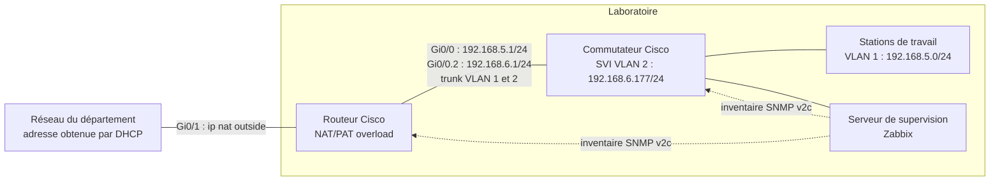

# Plan d'architecture réseau du laboratoire

**Routeur et commutateur Cisco physiques : accès Internet par NAT/PAT et préparation de l'inventaire SNMP**

| Élément | Contenu |
|---|---|
| **Référent** | La configuration d'un routeur et d'un commutateur Cisco physiques : NAT/PAT vers le réseau du département, sous-interface VLAN 2 (802.1Q) et SNMP v2c. |
| **Émetteur** | Bariu Azeez |
| **Message** | Permettre de recâbler et de reconfigurer le réseau du laboratoire à partir de zéro, puis de le préparer à la supervision par SNMP. |
| **Récepteur** | Étudiants et techniciens du laboratoire de supervision |
| **Canal** | Dépôt GitLab du cours (Collège de Rosemont), republié sur GitHub |
| **Code** | Français |
| **Référence** | [Cisco — Configure Network Address Translation](https://www.cisco.com/c/en/us/support/docs/ip/network-address-translation-nat/13772-12.html) · [Cisco — Configure SNMP Community Strings](https://www.cisco.com/c/en/us/support/docs/ip/simple-network-management-protocol-snmp/7282-12.html) · [documentation du cours 420-H03-RO (Moodle, accès réservé)](https://crosemont.moodle.decclic.qc.ca/course/view.php?id=5563&section=3) |

---

## Topologie



| Équipement | Interface | Adresse | Rôle |
|---|---|---|---|
| Routeur | `Gi0/1` | DHCP (réseau du département) | Côté extérieur du NAT (`ip nat outside`) |
| Routeur | `Gi0/0` | `192.168.5.1/24` | Passerelle du VLAN 1, côté intérieur du NAT |
| Routeur | `Gi0/0.2` | `192.168.6.1/24` | Passerelle du VLAN 2 (encapsulation 802.1Q) |
| Commutateur | `interface vlan 2` | `192.168.6.177/24` | Adresse de gestion interrogée par SNMP |
| Commutateur | `Gi0/1` | — | Lien trunk vers le routeur (VLAN 1 et 2) |

## Prérequis

- Un routeur Cisco physique
- Un commutateur Cisco physique
- Un câble console et un logiciel de terminal

## Câblage

> [!IMPORTANT]
> La configuration exige un câblage précis :
> - le port `Gi0/0` du routeur est relié au commutateur ;
> - le port `Gi0/1` du routeur est relié au port `LINK LOCAL` du réseau du département ;
> - les stations de travail utilisent n'importe quel autre port du commutateur.

## Procédure pour le routeur

1. Connectez-vous au routeur par le port console.
2. Effacez la configuration existante, puis redémarrez :
   ```
   erase startup-config
   reload
   ```
3. Saisissez `enable` puis `conf t` pour passer en mode de configuration globale (l'invite devient `Router(config)#`).
4. Collez la configuration ci-dessous et appuyez sur Entrée.

### Configuration du routeur

```
hostname Routeur
!
interface Embedded-Service-Engine0/0
!
interface GigabitEthernet0/0
 description Port connecte a votre switch
 ip address 192.168.5.1 255.255.255.0
 ip nat inside
 duplex auto
 speed auto
 no shut
!
interface GigabitEthernet0/1
 description Port connecte au reseau du departement
 ip address dhcp
 ip nat outside
 duplex auto
 speed auto
 no shut
!
access-list 1 permit any
ip nat inside source list 1 interface GigabitEthernet0/1 overload
!
end
!
```

### Sauvegarder la configuration

```
copy running-config startup-config
```

## Procédure pour le commutateur

1. Connectez-vous au commutateur par le port console.
2. Effacez la configuration existante, puis redémarrez le commutateur :
   ```
   erase startup-config
   reload
   ```

---

## Étape suivante : inventaire SNMP des équipements physiques

Pour que le serveur de supervision puisse inventorier les équipements, le routeur et le commutateur doivent répondre aux requêtes SNMP.

### SNMP v2c sur le routeur

```
snmp-server community Routeur-reseaux-locaux
snmp-server location E-305-rosemont
snmp-server contact equipe1
```

> [!NOTE]
> Le commutateur demande une configuration supplémentaire, sur lui-même **et** sur le routeur : il lui faut une adresse IP de gestion pour être interrogé.

### SNMP v2c sur le commutateur

```
snmp-server community Switch-reseaux-locaux
snmp-server location E-305-rosemont
snmp-server contact equipe1
```

### Adresse de gestion du commutateur

```
!
hostname Switch
!
interface vlan 2
 ip address 192.168.6.177 255.255.255.0
 no shutdown
!
ip default-gateway 192.168.6.1
! port GigabitEthernet0/1 connecté au routeur en mode trunk pour transporter les VLANs
interface GigabitEthernet0/1
 switchport mode trunk
 switchport trunk allowed vlan 1,2
 no shutdown
!
```

### Sous-interface VLAN 2 sur le routeur

```
! Sous-interface pour le VLAN 2 (réseau 192.168.6.0/24)
interface GigabitEthernet0/0.2
 encapsulation dot1Q 2
 ip address 192.168.6.1 255.255.255.0
 ip nat inside
 no shutdown
!
interface GigabitEthernet0/1
 description Port connecte au reseau du departement
 ip address dhcp
 ip nat outside
 duplex auto
 speed auto
 no shutdown
!
access-list 1 permit any
!
ip nat inside source list 1 interface GigabitEthernet0/1 overload
!
ip route 0.0.0.0 0.0.0.0 GigabitEthernet0/1
!
end
```

### Sauvegarder la configuration

```
copy running-config startup-config
```

> [!WARNING]
> SNMP v2c transmet la communauté en clair. Il convient à un laboratoire isolé ; en production, on utilise SNMP v3 (authentification et chiffrement).
