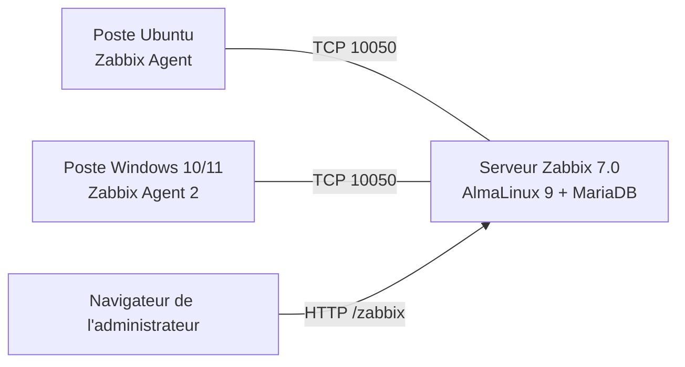

# Zabbix — Laboratoire 1 : serveur et agents

[← Retour au cours 420-H63](../README.md)

## Objectif

Installer un serveur **Zabbix 7.0 LTS** sur AlmaLinux 9, puis y rattacher un poste **Ubuntu** et un poste **Windows** équipés de l'agent Zabbix, et vérifier que les premières données remontent.



## Documents

| Ordre | Document | Contenu |
|---|---|---|
| 1 | [Installation Zabbix-Server (AlmaLinux-9).md](<Installation Zabbix-Server (AlmaLinux-9).md>) | Préparation de l'OS, MariaDB, dépôt Zabbix 7.0 LTS, import du schéma SQL, `zabbix_server.conf`, pare-feu, vérifications web, dépannage (« Zabbix server is running: No », interface web inaccessible, réinitialisation du mot de passe Admin) |
| 2 | [Installation Zabbix-Agent (Linux).md](<Installation Zabbix-Agent (Linux).md>) | Agent Linux à partir de l'archive précompilée : déploiement des fichiers, configuration minimale, service systemd, vérifications côté client, désinstallation |
| 3 | [Installation Zabbix-Agent (Window).md](<Installation Zabbix-Agent (Window).md>) | Ajout de l'hôte Windows dans l'interface Zabbix (interface agent, port 10050, modèle `Windows by Zabbix agent`) et test avec `zabbix_get` |

## Technologies

AlmaLinux 9 · MariaDB · Apache / PHP-FPM · Zabbix Server, Agent et Agent 2 · systemd · firewalld · pare-feu Windows

## Vérification rapide

Depuis le serveur, chaque agent doit répondre `1` :

```bash
zabbix_get -s <IP_AGENT> -k agent.ping
```

> [!NOTE]
> Les adresses et mots de passe de ces guides sont ceux d'un laboratoire isolé du collège. Ne les réutilisez pas sur un serveur réel.
