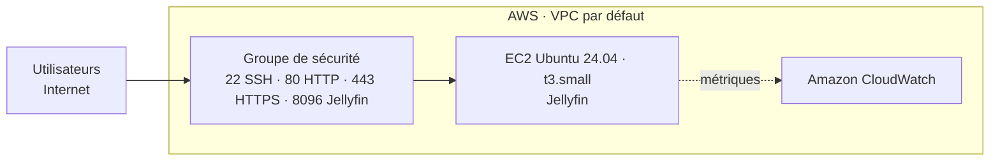

# Travail pratique 2.2 — Architecture réseau et groupe de sécurité de Jellyfin

**Instance EC2 et règles d'entrée du serveur Jellyfin**

| Élément | Contenu |
|---|---|
| **Référent** | L'instance EC2 Ubuntu 24.04 qui héberge **Jellyfin** et son groupe de sécurité (ports 22, 80, 443 et 8096). |
| **Émetteur** | Bariu Azeez, Abdul-Majid, Aran |
| **Message** | Documenter l'instance et justifier chaque port ouvert dans le groupe de sécurité. |
| **Récepteur** | M. Jérémy Massinon |
| **Canal** | Dépôt GitLab du cours (Collège de Rosemont), republié sur GitHub |
| **Code** | Français |
| **Référence** | [AWS — Groupes de sécurité EC2](https://docs.aws.amazon.com/AWSEC2/latest/UserGuide/ec2-security-groups.html) · [Documentation Jellyfin](https://jellyfin.org/docs/) |

---

## Schéma de l'architecture

## Architecture Réseautique et Configuration Base

- Une instance **Ubuntu Server 24.04 LTS**.  
- Type d’instance : **t3.small**  
- **Adresse IPv4 publique : 54.227.166.166**  
- **Adresse IPv4 privée : 172.31.30.137**  
---
- Résultat - Capture détails techniques de l’instance  
---

---

## Résultats Groupe de sécurité

**Voici les ports ouverts sur la machine :  **

| Type              | Protocole | Port | Source     | Description |
|-------------------|-----------|------|-------------|--------------|
| **SSH**           | TCP       | 22   | 0.0.0.0/0   | Permet connexion distant sécurisée sur le serveur. |
| **HTTP**          | TCP       | 80   | 0.0.0.0/0   | Permet accéder à la page web et vers HTTPS. |
| **HTTPS**         | TCP       | 443  | 0.0.0.0/0   | Permet un accès sécurisé avec SSL. |
| **TCP personnalisé pour Jellyfin** | TCP | 8096 | 0.0.0.0/0 | utilisation par la service Jellyfin. |

---
## Pourquoi ces règles ?

- Le port **22 (SSH)** ici est essentiel pour la connexion sur machine et faire les Configuration nécessaire.
- Le port **80 (HTTP)** ici est requis pour la redirection vers une page web securisé.
- Le port **443 (HTTPS)** ici est utilisé pour le chiffrement par SSL du site.
- Le port **8096** ici est le point de demarrage pour Jellyfin afin acceder à son interface web.  
---
- Résultat - Capture des règles de sécurité AWS  
---

---
