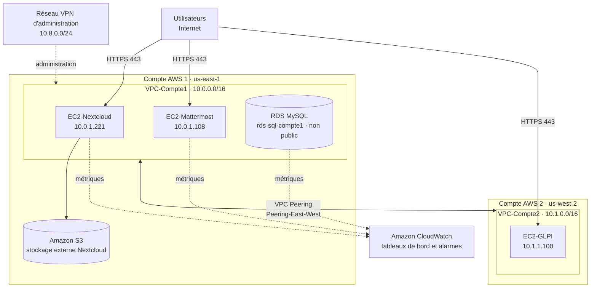

# TP final — Infrastructure cloud de Jey INC.

**Création d'une infrastructure AWS répartie sur deux comptes reliés par VPC Peering**

| Élément | Contenu |
|---|---|
| **Référent** | L'infrastructure cloud de l'entreprise fictive Jey INC. : GLPI, Mattermost, Nextcloud, RDS MySQL, VPN et CloudWatch sur deux comptes AWS (us-east-1 et us-west-2). |
| **Émetteur** | Bariu Azeez, Freddy, Abdul-Majid, Aran |
| **Message** | Présenter l'architecture livrée, l'organisation des preuves par service et les réponses aux questions théoriques. |
| **Récepteur** | M. Jérémy Massinon |
| **Canal** | Dépôt GitLab du cours (Collège de Rosemont), republié sur GitHub |
| **Code** | Français |
| **Référence** | [Amazon VPC](https://docs.aws.amazon.com/vpc/) · [VPC Peering](https://docs.aws.amazon.com/vpc/latest/peering/what-is-vpc-peering.html) · [Amazon CloudWatch](https://docs.aws.amazon.com/cloudwatch/) |

---

## Introduction
D’abord, l’objectif de ce travail pratique final est de déployer une première partie de l’infrastructure Cloud de Jey INC. en respectant le cahier des charges du TP finale.

Dans notre cas, on a mis en place :
- GLPI (inventaire + gestion) accessible sur Internet, avec inventaire sécurisé via VPN
- Mattermost (communication) accessible sur Internet
- Nextcloud (collaboration/stockage) accessible sur Internet, avec stockage externe S3
- VPN (accès d’administration + échanges sécurisés)
- CloudWatch (métriques + tableaux de bord + alarmes)

---

## Schéma de l'architecture

Construit à partir des documents d'architecture réseau de chaque service (adresses privées des VPC du laboratoire).

| Service | Compte / région | Documents |
|---|---|---|
| Nextcloud | Compte 1 · us-east-1 | [Architecture réseau](<Résultats-NEXTCLOUD/Résultats-ArchitectureReseau-NEXTCLOUD.md>) · [Preuves](<Résultats-NEXTCLOUD/Résultats-NEXTCLOUD.md>) |
| Mattermost | Compte 1 · us-east-1 | [Architecture réseau](<Résultats-MATTERMOST/Résultats-ArchitectureReseau-MATTERMOST.md>) · [Preuves](<Résultats-MATTERMOST/Résultats-MatterMost.md>) |
| GLPI | Compte 2 · us-west-2 | [Architecture réseau](<Résultats-GLPI/Résultats-ArchitectureReseau-GLPI.md>) · [Preuves](<Résultats-GLPI/Résultats-GLPI.md>) |
| RDS MySQL et VPC | Comptes 1 et 2 | [RDS MySQL](<Résultats-RDS+VPC/Résultats-RDS-MySQL.md>) · [VPC Compte 1](<Résultats-RDS+VPC/Résultats-VPC-COMPTE-1.md>) · [VPC Compte 2](<Résultats-RDS+VPC/Résultats-VPC-COMPTE-2.md>) |
| CloudWatch | — | [Tableaux de bord, métriques et alertes](<Résultats-V-CLOUDWATCH/Résultats-CLOUDWATCH.md>) |

---

## Schéma du livrable
Le livrable est divisé en plusieurs dossiers.  
Pour chaque service il existe :
1) un document Architecture réseau + Security Groups 
2) un document Preuves d’installation et de fonctionnement

---

## Questions théoriques

### Question 1 – Deux solutions Cloud (autres que AWS/Azure/GCP)
- Réponse personnelle : Nous avons sélectionné Linode (ou Akamai) et Vultr. Ce sont de bons fournisseurs car ils sont moins complexes 
à gérer. 

Solution A: Pour Linode, notre choix s'est basé sur la simplicité de la facture. Contrairement à AWS où on paie le trafic sortant au Go, 
Linode inclut un gros volume de données dans le prix du serveur.

- Avantages : 
Coûts prévisibles : Contrairement à AWS où le calcul de la bande passante est un peu compliqué, Linode inclut un quota de transfert qui
est par exemple de 1TB le plan de base dans le prix du serveur. C'est plus facile à gerer et cela nous permet de mieux voir nos dépenses.
Proximité : Ils ont aussi une région à Toronto, ce qui est parfait pour la latence. Ce n'est pas loin.
Documentation : Leurs guides et documentations sont beaucoup plus simple pour les débutants que la documentation technique d'AWS.

- Inconvénients : Ils ont moins de services géré automatiquement comme ils n'ont pas d'outils d'intelligence artificielle. Le système de 
pare-feu et de réseau privé est plus basique que les VPC qu'on a  dans AWS.

- Sources :  (liens)
Aller dans la section Essential Compute plans et cliquer Shared CPU
Prix et Transfert inclus : https://www.linode.com/pricing/

Carte des régions (Toronto) : https://www.linode.com/global-infrastructure/

Solution B: Pour Vultr, on l'a choisi pour la performance matérielle. Pour presque le même prix qu'une instance AWS de base, ils offrent 
des processeurs à haute fréquence et du stockage très rapide, ce qui est mieux pour notre base de donnée.

- Avantages : 
Performance : Vultr propose des serveurs de haute fréquence avec des processeurs à plus de 3GHz et du stockage NVMe rapide. Pour le mê
prix qu'une instance AWS standard, on a une machine beaucoup plus performante. C'est mème l'idéal pour notre base de données.
Choix du système d'exploitation : Ils supportent aussi nativement Ubuntu 22.04 LTS. C'est la version qu'on a utilisé donc cela facilite 
aussi la migration.

- Inconvénients : Le support technique de base se fait uniquement par tickets donc c'est pas très rapide. Ils n'ont pas aussi l'écosystème
 géant d'Amazon pour les services annexes comme la gestion de réseaux avancés, la sécurité ou les base de données managées automatiquement.

- Sources :  (liens)
Détails techniques : https://www.vultr.com/products/high-frequency-compute/

Comparatif de prix : https://www.vultr.com/pricing/

### Question 2 – Avis sur les exigences du client + le Cloud est-il la meilleure solution ?
- Réponse personnelle : 
Avis sur les exigences : Nous avons trouvé les exigences très strictes sur la sécurité comme par exemple au niveau du VPN et de HTTPS.
C'est un bon point mais le fait de séparer l'infrastructure sur deux comptes AWS différents est un peu contre-productif pour cette architecture.
Cela nous a obligés à configurer un VPC Peering complexe et à gérer des tables de routage croisées qui sont difficiles à déboguer. Normalement, 
pour une entreprise de la taille de Jey INC., cela augmente le risque d'erreur humaine comme cela nous est arrivé. Par exemple,
le fait d'oublier une route ou de mal configurer un Security Group amène beaucoup de problème et n'apporte pas vraiment d'avantage par rapport 
à l'utilisation de simples sous-réseaux ou d'un seul VPC bien segmenté.

Le cloud est-il la meilleure solution ? Oui, mais cela dépend de ce qu'on veut faire. C'est l'idéal au niveau de la rapidité de déploiement.
Par exemple ici, on a monté l'infra en quelques jours, alors que commander des serveurs prend des semaines et ensuite il faut faire la 
configuration, sans parler du fait que ce sera plus cher de tout acheté maintenant que de payer selon notre utilisation vu que nous somme une
petite entreprise qui débute et n'avons pas ce budget.

### Question 3 – Avantages du local + robustesse + 3 pistes d’amélioration
- Réponse personnelle : 
Avantages du Local : Bien que le cloud soit à la mode, si ont hébergeait cette infrastructure en local, on aurait trois avantages majeurs :

Performance des transferts Nextcloud : Pour notre application de stockage de fichiers qui est Nextcloud, le réseau local est le meilleur 
environnment. Par exemple, on pourrait transférer des fichiers de 5 Go se fait en quelques secondes avec un câble réseau, alors que sur le Cloud,
 on dépend de la vitesse de la connexion internet.

Confidentialité stricte : Les données de l'inventaire GLPI seront plus sécurisé car en local, les disques durs sont dans une salle fermée à clé. 
Sur AWS, on partage le matériel avec d'autres clients de AWS.

Coût fixe : En local, une fois que le serveur est payé, il nous appartient. Alors que sur AWS même les transferts de données sortants sont 
facturés. En local, c'est gratuit.

L'infrastructure est-elle suffisamment robuste ? Non, note infrastructure actuelle n'est pas robuste car elle utilise des instances uniques. 
Par exemple, si nous devons mettre à jour le serveur Mattermost, il faut l'éteindre et cela coupe le service pour toute l'entreprise. 
Pour que nous puissons considéré notre infrastructure comme robuste, on doit pouvoir survivre à une panne matérielle ou à une maintenance sans 
couper le service.

- Trois améliorations concrètes : 

Mettre en place un load balancer: Actuellement, nos utilisateurs se connectent directement à l'IP du serveur. Si le serveur change d'IP ou 
tombe en panne, on n'a plus de connexion. Un load balancer permettra de diriger le trafic vers plusieurs serveurs et de détecter si l'un 
d'eux est en panne pour ne plus lui envoyer de trafic.

Protection Web avec AWS WAF : Dans le TP, nous avons ouvert le port 443 au monde entier (0.0.0.0/0) pour Nextcloud et GLPI. Donc n'importe qui
peut essayer d'eccéder à nos logiciels. Ajouter AWS WAF devant le Load Balancer permettra de bloquer les attaques comme le SQL injection avant
qu'elles n'atteignent nos serveurs.

Sauvegardes automatisées avec AWS Backup : Nous n'avons pas de stratégie de backup. Nous pouvons alors utiliser le service AWS Backup pour faire
une configuration de sauvegarde qui prend un snapshot des serveurs et de la base RDS chaque nuit à par exemple 3h00 du matin, et il le gardera
pendant 30 jours au cas ou on aurait besoin de revenir à un état antérieur.

- Sources :  (liens)

AWS WAF (Sécurité) : https://aws.amazon.com/waf/

AWS Backup (Plan de sauvegarde) : https://aws.amazon.com/backup/

Comparatif Latence Local vs Cloud : https://www.backblaze.com/blog/cloud-vs-on-premise-storage/

---
